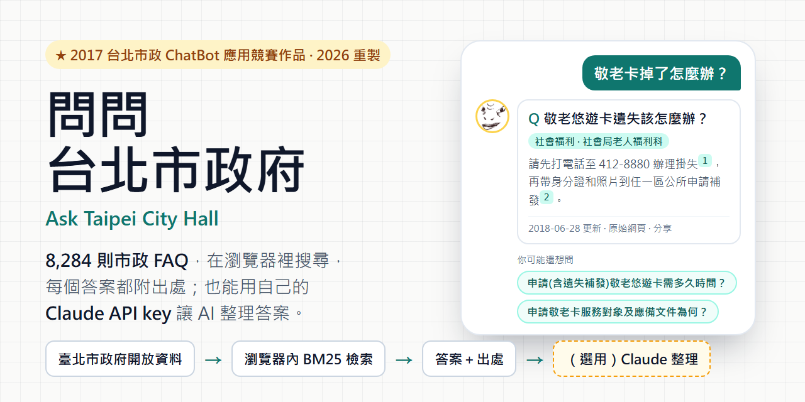
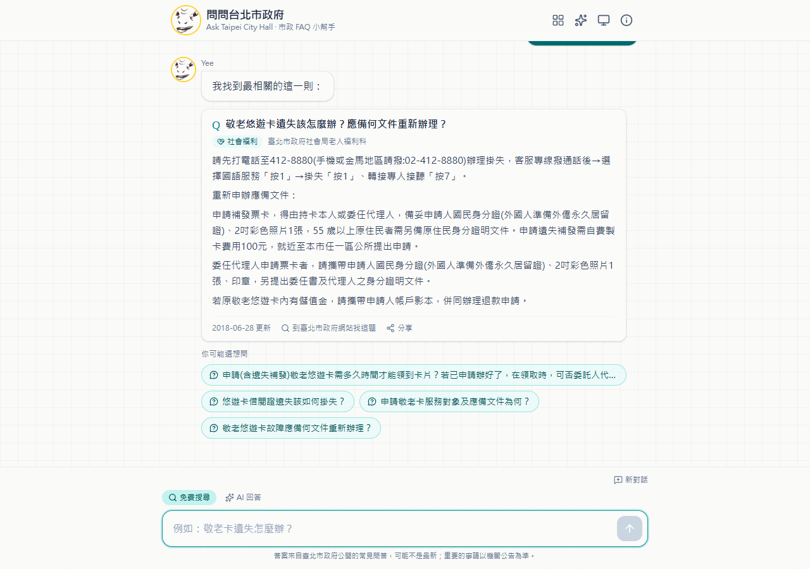
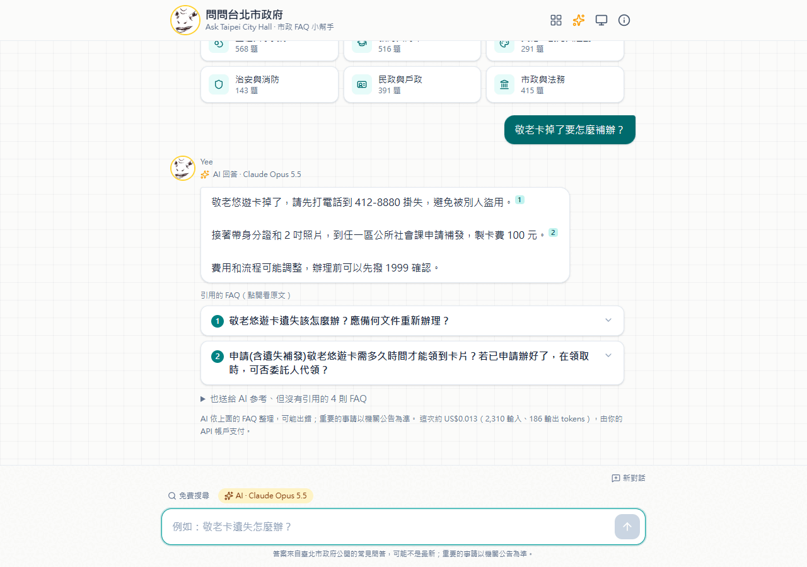
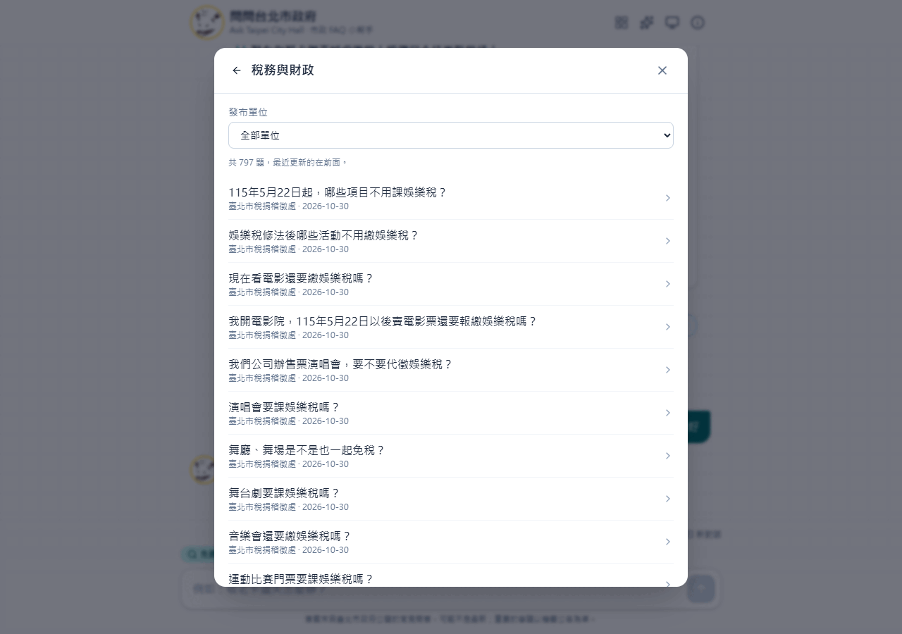
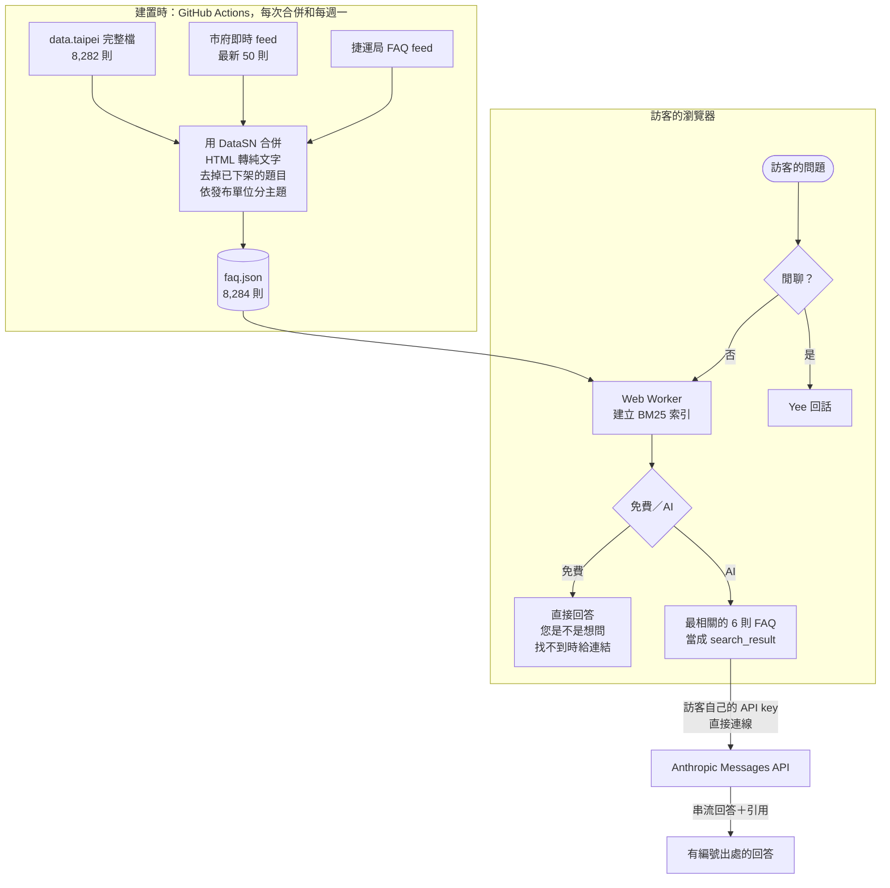

<p align="center">
  
</p>

> **2017 台北市政 ChatBot 應用競賽作品，2026 年重新改寫。**
> 這個專案原本是參加「[2017 臺北市政 ChatBot 應用競賽](https://taipei.join.gov.tw/policies/detail/80c6fa3c-30a7-4899-8c88-de73349b4619)」的聊天機器人，掛在 Facebook 粉專和 LINE 上回答市政問題，可惜沒有入選。
> 2026 年改寫成不需要伺服器的網頁，並可以選擇接上 Claude。

# 問問台北市政府 Ask Taipei City Hall

[](https://github.com/NatLee/ask-taipei-city-hall/actions/workflows/ci.yml)
[](https://github.com/NatLee/ask-taipei-city-hall/actions/workflows/pages.yml)
[](LICENSE)
[](https://data.gov.tw/license)

用自己的話問台北市政的問題，網頁會從臺北市政府公開的 **8,000 多則常見問答**裡找出答案，附上發布機關、更新日期和原始網頁。
搜尋在你的瀏覽器裡進行，不用帳號、不收費，問題也不會送到任何伺服器。
想要更口語的整理，可以貼上自己的 Claude API key 開啟 AI 模式：Claude 只根據找到的 FAQ 回答，每個重點都標出出處，FAQ 沒寫的它會直說沒有。

**線上使用：<https://natlee.github.io/ask-taipei-city-hall/>**

## 功能

- **免費搜尋**：BM25 中文檢索，在 Web Worker 裡執行，打字不卡。
- **跟 2017 版一樣的回答方式**：
  - 很有把握時直接給答案，附「你可能還想問」。
  - 有幾題差不多時，列出「您是不是想問…？」。
  - 找不到時，給臺北市政府網站、Google 和 1999 市民熱線的連結。
- **AI 模式（選用）**：Claude 依找到的 FAQ 回答，串流顯示，每個重點都附編號出處，可以點開原文對照。答案下方會顯示這次大約花了多少錢。
- **依主題瀏覽**：15 個主題，可以再依發布單位篩選，最近更新的排前面。
- **分享**：每個答案都能分享成連結（`?q=問題`），打開就會自動問那一題。
- **閒聊和吉祥物 Yee**：保留 2017 版的閒聊語料，拿掉過時和不禮貌的句子。
- 手機優先的版面、深色模式、鍵盤操作和螢幕閱讀器標註；輸入中文時，選字中按 Enter 不會誤送出。

## 截圖

| 直接回答，附出處和相關問題 | AI 模式（截圖用模擬回應） |
|---|---|
|  |  |

| 手機、深色模式：「您是不是想問」與找不到時的退路 | 依主題瀏覽 |
|---|---|
|  |  |

AI 模式的截圖用的是本機建置版加上模擬的 API 回應，不是真的 Claude 回答；其他截圖都是實際畫面。

## 怎麼運作



### 資料怎麼來的

建置時，`scripts/data/build.ts` 依 [`data/sources.json`](data/sources.json) 下載三份開放資料：

| 資料集 | 用途 |
|---|---|
| [臺北市市政網站整合平台之常見問答](https://data.taipei/dataset/detail?id=203f1657-bb4a-45a7-b25f-279b63136645)（完整檔） | 主要內容，8,282 則，2007 到 2026 年 |
| 同一資料集的「最新 50 筆」feed | 補上完整檔還沒有的新題目，以及每題的原始網頁 |
| [臺北市政府捷運工程局常見問答](https://data.taipei/dataset/detail?id=cb7269a6-2614-4a91-a6b4-bd2a20d6ec65) | 補上捷運工程相關題目的原始網頁 |

接著把三份資料依題目編號（DataSN）合併，把答案的 HTML 轉成純文字並保留連結和附件，去掉機關已經設定下架的題目，再依發布單位分成 15 個主題（規則在 [`data/categories.json`](data/categories.json)）。
原始資料不放進 repo，每次部署時重新下載。下載失敗時會用 Actions 快取裡上一次成功的版本，題目少於 1,000 則就停止部署，避免把網站換成空的。

### 檢索怎麼運作

- **斷詞**：中文沒有空格，所以索引同時用三種詞：
  - 每兩個字一組的「二元組」（不需要詞典，每個瀏覽器結果都一樣）。
  - 瀏覽器內建斷詞（`Intl.Segmenter`）切出的整詞。這個角色在 2017 版是 jieba。
  - 問題標題裡的單字，讓「狗」這種一個字的問題也找得到。
- **排序**：BM25F，問題標題的權重最高，答案和發布單位次之。前 50 名再依「問題裡的詞有多少出現在這則 FAQ」重新排序。
- **前處理**：
  - 拿掉「請問、怎麼、是誰」這類只表示發問的字。
  - 「臺」和「台」視為同一個字。
  - 一份短短的同義詞表把口語對應到市府用語，例如「狗」對到「犬」、「不見了」對到「遺失」，規則在 [`src/search/vocabulary.ts`](src/search/vocabulary.ts)。
- **要不要直接回答**：
  - 最佳結果的標題涵蓋問題八成以上，而且明顯贏過第二名，就直接回答。
  - 否則列出三個候選。
  - 連三成五都不到，就說找不到。

用真實資料測過 20 個問題，逐題結果在 [PR #1 的評估表](https://github.com/NatLee/ask-taipei-city-hall/pull/1)。大部分口語問題都能找到對的題目。
免費模式只比對字詞，所以也有失手的時候：
- 「違規停車罰單怎麼繳」會先給「紅線違規停車罰鍰費用為多少？」。
- 「火星移民」會因為「移民」兩個字列出新住民的題目。

需要理解語意的問題，AI 模式會處理得比較好。

**為什麼沒有用向量模型（embeddings）**：

| 項目 | 下載量 |
|---|---|
| 最小的中文向量模型 `bge-small-zh-v1.5`（int8） | 24 MB |
| ONNX 執行環境 | 約 10 MB |
| 8,000 多則 FAQ 的向量 | 約 4 MB |
| 現在的 BM25 版本 | faq.json 經 gzip 後約 2.2 MB |

向量模型合計約 38 MB，是現在的 15 倍以上，在手機網路上不划算。語意理解交給選用的 AI 模式。

在這台電腦用 Edge 模擬手機（CPU 降速 4 倍、9 Mbps 網路），頁面約 0.6–0.8 秒出現，FAQ 約 3 秒後可以搜尋；一般桌機約 1.2–2.4 秒。真的手機沒有測過。

## AI 模式：費用與風險

AI 模式從你的瀏覽器直接呼叫 Anthropic Messages API，請求會帶 `anthropic-dangerous-direct-browser-access` 標頭，中間不經過任何伺服器。
每個問題會送出最相關的 6 則 FAQ（`search_result` 區塊，開啟引用功能）和你的問題。
- **模型**：預設 Claude Opus 5.5，可以改成 Sonnet 5.5 或 Haiku 5.5。
- **設定**：`effort: low`，每題上限 4,096 tokens。
- **安全拒答的備援**：Opus 和 Sonnet 開啟 `fallbacks: "default"`，被安全機制拒答時，由 API 自動換模型重試。Haiku 沒有這個功能。

**費用由你的 Anthropic 帳戶支付。**
- 以 Opus 5.5 估計每題約 US$0.01–0.05；Sonnet 約一半；Haiku 不到 US$0.005。
- 追問時會帶上前面的對話，有快取所以比較便宜。
- 每個回答下面會顯示這次實際用了多少 tokens 和大約多少錢。

**使用前請了解：**

- **金鑰存在哪**：預設只放在分頁的記憶體裡，關掉或重新整理就忘記。勾選「在這台裝置記住金鑰」才會存進 localStorage，直到你按「忘記金鑰」。
- **誰可能讀到**：存進 localStorage 後，能使用這個瀏覽器的人、或惡意的瀏覽器擴充功能，都可能讀到金鑰。公用電腦請不要勾選。
- **網頁的限制**：網頁設定了 Content-Security-Policy，只允許連到自己和 `api.anthropic.com`，金鑰無法被送到其他網址。
- **建議做法**：為這個網站另外建一把金鑰，並在 [Claude Console](https://platform.claude.com/settings/limits) 設定用量上限；用完可以直接刪除。
- **個人資料**：你的問題和找到的 FAQ 會送給 Anthropic 處理，請不要輸入身分證字號等個人資料。

## 自己架設或開發

需要 Node.js 22.12 以上。

```bash
git clone https://github.com/NatLee/ask-taipei-city-hall.git
cd ask-taipei-city-hall
npm ci
npm run data:build   # 下載開放資料，產生 public/data/faq.json（約 7 MB）
npm run dev          # http://localhost:5173
```

沒有網路或只想快速試試，可以改用 repo 裡的小樣本（約 90 則）：

```bash
npm run data:sample
```

其他指令：

```bash
npm test            # Vitest：斷詞、檢索、資料清理、AI 請求（模擬 API）、金鑰保存
npm run lint
npm run typecheck
npm run build       # 輸出到 dist/；部署到子路徑時設定 BASE_PATH，例如 BASE_PATH=/ask-taipei-city-hall
```

部署由 [`.github/workflows/pages.yml`](.github/workflows/pages.yml) 負責：每次合併到 `main`、每週一早上 4 點（台北時間）都會重新抓資料、重新建置。
GitHub 會在 repo 60 天沒有活動時暫停排程，屆時到 Actions 頁面按一下就能恢復。

## 資料來源與授權

- 市政 FAQ 來自臺北市政府資訊局、臺北市政府捷運工程局在[臺北市資料大平臺](https://data.taipei/)開放的資料，依[政府資料開放授權條款－第1版](https://data.gov.tw/license)使用。
- `scripts/data/fixtures/` 是同樣這些資料的小樣本，供測試使用。
- 閒聊語料來自 2017 版：當年隊員從 [ChatterBot corpus](https://github.com/gunthercox/chatterbot-corpus)（BSD-3-Clause）翻成中文。
- 程式碼採用 [Apache License 2.0](LICENSE)。
- 這不是臺北市政府的官方服務；答案以各機關最新公告為準。

## 2017 版與團隊

2017 版是 Flask 加上 Facebook Messenger 和 LINE 的 webhook，用 jieba 斷詞，再比對 8,515 則市政 FAQ 和自製的閒聊語料。
Messenger 和 LINE 機器人依專案擁有者的決定退役，由這個網頁取代。當年的運作方式、程式連結和功能對照，整理在 [`docs/2017-chatbot.md`](docs/2017-chatbot.md)。

2017 團隊：

- [NatLee](https://github.com/NatLee)
- 張語航（[changyuhang](https://github.com/changyuhang)，2017 年的 PR 都由他開出）
- impaulapple

完整的 211 個 commit 都保留在這個 repo 的歷史裡。

## English summary

**Ask Taipei City Hall** is a 2026 rewrite of a chatbot built for the *2017 Taipei City Government ChatBot contest*.
The original bot answered questions on Facebook Messenger and LINE; this version is a static web page on GitHub Pages.

- **Free mode**: searches 8,000+ official Taipei City Government FAQs (open data, fetched at build time) entirely in the browser. It uses BM25 with Chinese character bigrams plus `Intl.Segmenter` words, and every answer links to its source.
- **AI mode (opt-in)**: visitors paste their own Claude API key. The browser calls the Anthropic Messages API directly and sends the top FAQ entries as cited search results, so the answer streams in with numbered citations. If the FAQ does not cover the question, Claude says so.
- **The key**: stays in memory unless the visitor chooses "remember on this device". Costs go to the visitor's own Anthropic account.

Built with React, Tailwind CSS, Vite and TypeScript; tested with Vitest. Code is Apache-2.0; the data is under Taiwan's Open Government Data License v1.0.
