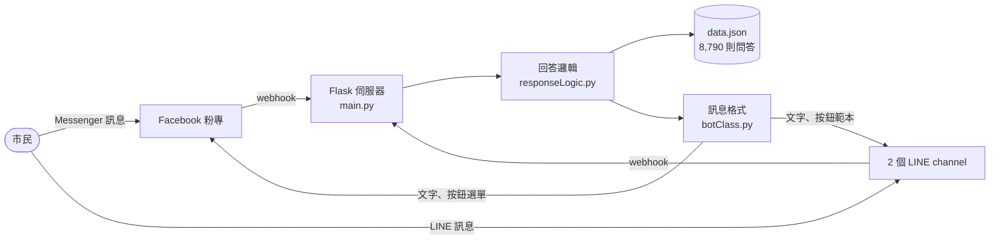

# 2017 版：Facebook 和 LINE 上的台北市政聊天機器人

這個專案原本是 2017 年「[臺北市政 ChatBot 應用競賽](https://taipei.join.gov.tw/policies/detail/80c6fa3c-30a7-4899-8c88-de73349b4619)」的參賽作品。
當時它是一個聊天機器人，掛在 Facebook 粉絲專頁和兩個 LINE 官方帳號上，市民可以直接傳訊息問台北市政的問題。
作品最後沒有入選。2026 年改寫成現在的網頁版，Messenger 和 LINE 機器人依專案擁有者的決定退役。

這份文件記錄 2017 版怎麼運作，方便對照新版。舊程式都還在 git 歷史裡，下面的連結指向 2017 年最後一個版本
（commit [`c945596`](https://github.com/NatLee/ask-taipei-city-hall/tree/c945596093001a8e74705cc0f519e1cf6192ab85)）。
公開前，歷史裡的 Facebook 和 LINE 憑證都已換成 `***REMOVED***`。

## 架構

- 伺服器是一個 Flask 程式，用 Docker compose 跑在 port 5000。Facebook 打 `/callbackFB`，兩個 LINE channel 分別打 `/callback1`、`/callback2`。
- 早期版本用 [ChatterBot](https://github.com/gunthercox/ChatterBot) 加 MongoDB 存語料，還寫了自訂的 logic adapter（`myLogicAdapter.py`）。
  後來改成直接讀一個 JSON 檔自己比對，速度比較快，最後的版本已經不需要 ChatterBot。
- 回答的資料 `src/data.json` 有 8,790 則：8,515 則來自台北市「市政網站整合平台之常見問答」（2017-08-07 的資料），另外 275 則是閒聊。

## 回答邏輯

程式在 [`src/lib/responseLogic.py`](https://github.com/NatLee/ask-taipei-city-hall/blob/c945596093001a8e74705cc0f519e1cf6192ab85/src/lib/responseLogic.py)。每收到一句話，就跟全部 8,790 則問題比兩次：

1. **整句相似度**：用 Python 的 `difflib.SequenceMatcher` 算使用者輸入和原始問題的相似度，留下最高的 3 則。
2. **斷詞覆蓋率**：每則問題事先斷好詞（欄位 `qu_new`）。程式檢查這些詞出現在使用者輸入的哪些位置，算出「輸入裡有多少比例的字被蓋到」。全部蓋到的題目列為候選，最多 3 則。

接著依信心決定怎麼回：

| 情況 | 2017 版怎麼回 |
|---|---|
| 最像的那則相似度超過 0.65 | 直接回答案 |
| 沒把握，但有候選 | 送出「您是不是想問…？」選單，最多 3 個市政問題，點了就送出那題 |
| 完全找不到 | 道歉加顏文字，附一個用 Google 搜尋原問題的按鈕 |

選單只放市政 FAQ，不放閒聊；相似度 0.2 以下的也不放。

## 訊息格式和其他細節

程式在 [`src/lib/botClass.py`](https://github.com/NatLee/ask-taipei-city-hall/blob/c945596093001a8e74705cc0f519e1cf6192ab85/src/lib/botClass.py)、
[`lineBotBuild.py`](https://github.com/NatLee/ask-taipei-city-hall/blob/c945596093001a8e74705cc0f519e1cf6192ab85/src/lib/lineBotBuild.py)、
[`fbBotBuild.py`](https://github.com/NatLee/ask-taipei-city-hall/blob/c945596093001a8e74705cc0f519e1cf6192ab85/src/lib/fbBotBuild.py)。

- Facebook 回答前會先送「正在輸入」。答案超過 600 字時改用長文字格式。
- LINE 的答案超過 1,500 字時，拆成好幾則訊息依序推送。
- LINE API 出錯時，回「啊哦！關於這個問題或許我們遇到了點麻煩。」
- 找不到答案時的訊息是「(,,・ω・,,)對不起我不太懂您的問題，我餵了估狗，希望對您有幫助」。
- 每次對話都寫進 `userdata.log`：使用者名稱、問題、回答、處理時間。

## 資料前處理

- `json2txt.js`：把資料平台下載的 `PortalFaq.json` 轉成「問題、答案」的純文字。
- `dataPrep/jiebaTest.py`：用 jieba 把每則問題斷詞，去掉標點，寫回 YAML 語料。
- `dataPrep/main.swift`：用 macOS 的 `NSLinguisticTagger` 做同樣的斷詞，是另一種斷詞工具的嘗試。
- `trainingData/*.yml`：ChatterBot 格式的語料。`TaipeiQA.yml` 是市政 FAQ，其他檔案是隊員翻成中文的閒聊（打招呼、機器人自我介紹、情緒、AI 等）。

## 2026 網頁版保留了什麼

| 2017 功能 | 網頁版 |
|---|---|
| 市政 FAQ 問答 | 保留。改用 BM25 檢索，資料在建置時從 data.taipei 抓最新版 |
| 斷詞 | 保留這個做法。改用瀏覽器內建的斷詞（`Intl.Segmenter`）加上字元二元組，不用再預先斷詞 |
| 「您是不是想問…？」 | 保留，一樣最多列 3 題 |
| 找不到時附搜尋連結 | 保留，改連到臺北市政府網站搜尋，也附 Google 和 1999 市民熱線 |
| 閒聊和吉祥物 Yee | 保留還適用的閒聊，拿掉過時或不適合的（例如 2017 年的市長、罵人的對話） |
| 「正在輸入」 | 保留，改成打字中的動畫 |
| 長答案分段 | 網頁不需要拆訊息，長答案改成可以展開 |
| 錯誤訊息 | 保留，改成說明清楚發生什麼事 |
| 對話紀錄 | 拿掉。網頁版沒有伺服器，訪客的問題不會被記錄 |
| Facebook、LINE、Flask、Docker | 依專案擁有者的決定退役，由網頁取代 |

## 2017 團隊

- NatLee
- 張語航（GitHub：changyuhang）
- impaulapple
